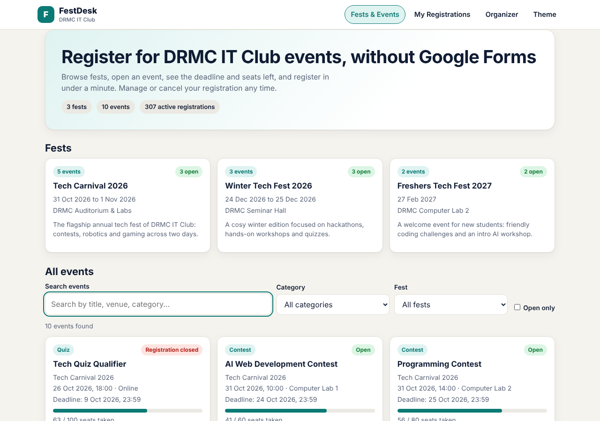
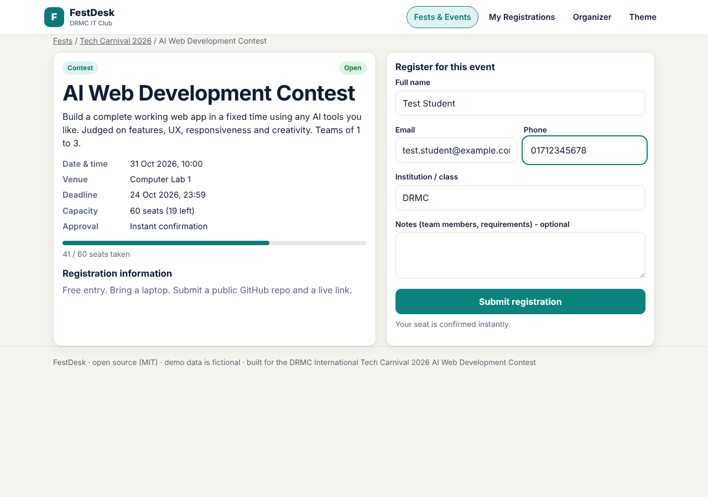
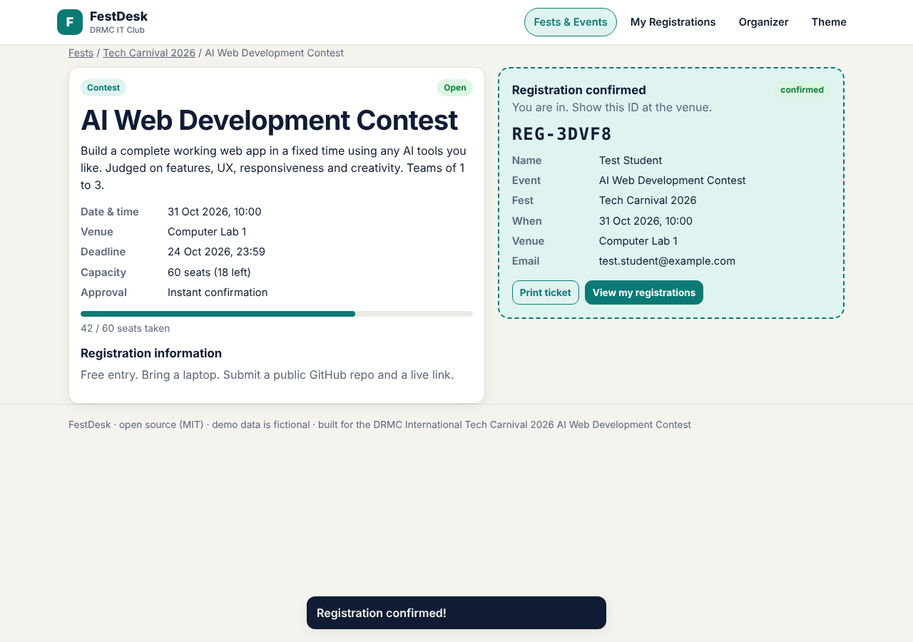
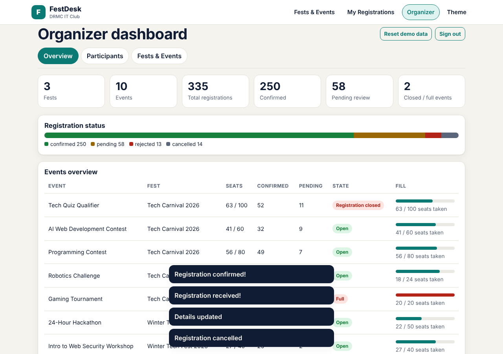
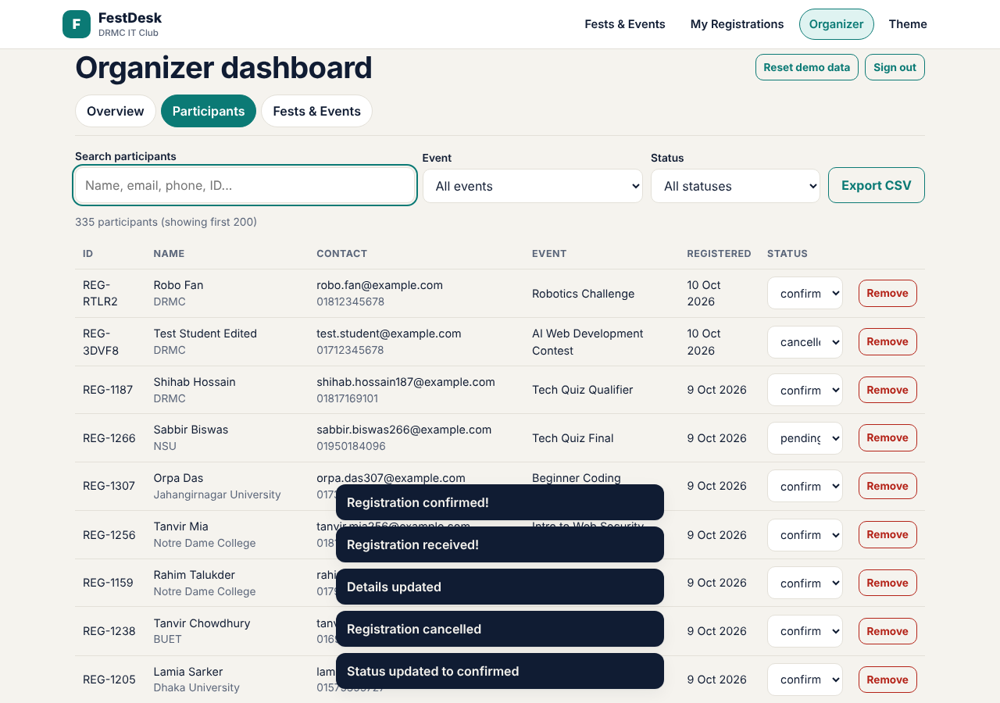
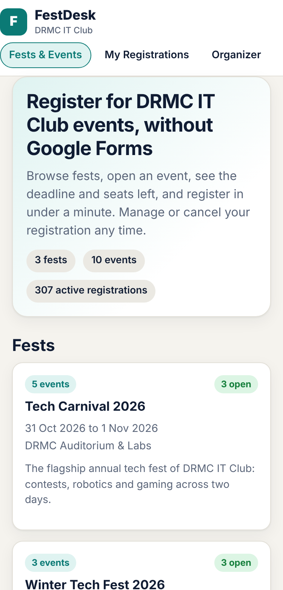
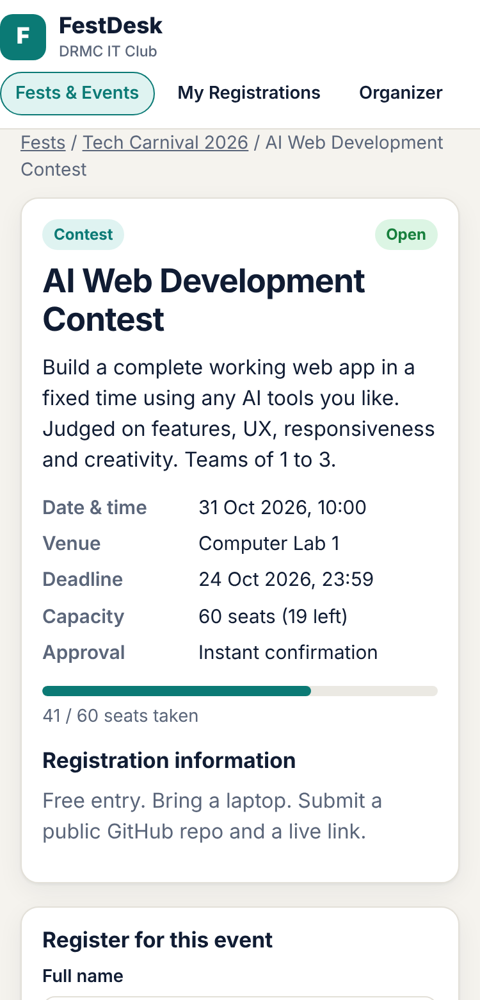
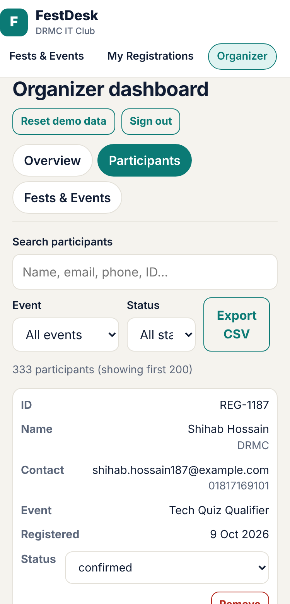

# FestDesk

**A fest, event and registration platform for student organizations. No Google Forms needed.**

Built for the **9th DRMC International Tech Carnival 2026: AI Web Development Contest** (theme: *Smart Club Operations*).

**Live demo:** https://festdesk.netlify.app
**Repository:** https://github.com/adelpierocurl420-coder/stepmath-bsc

## Project description

FestDesk models the hierarchy from the contest brief:

```
Organization -> Fest -> Event -> Registration
```

Students browse fests, open an event, see its date, venue, deadline and seats left, and register through a built-in form. They get an instant confirmation ticket and can later view, edit or cancel their registration. Organizers get a dashboard to manage fests and events, review participants, change registration status and export data.

The demo is pre-loaded with **DRMC IT Club** data: 3 fests, 10 events and about 330 mock participants, so judges can evaluate everything immediately without creating data first.

## Features

**Fest directory**
- Upcoming fests with event counts and how many events are still open
- Event cards showing category, fest, date, venue, deadline, a live seats-taken bar and an Open / Few seats left / Full / Registration closed badge
- Search events (title, description, venue, category, fest name)
- Category filter, fest filter and an "Open only" toggle
- Fest detail page listing its events; event detail page with description, date and time, venue, capacity, deadline and registration information

**Registration system**
- Registration form with validation (name, email, phone, institution, optional notes)
- Instant confirmation ticket with a registration ID and a print option
- Capacity and deadline enforcement (full or past-deadline events accept no registrations)
- Duplicate-registration protection per event and email
- Two approval modes per event: instant confirmation or organizer approval (starts as Pending)
- **My Registrations**: look up by email, edit your details, cancel (frees the seat)

**Organizer dashboard** (login required)
- Overview: KPIs, status breakdown bar and per-event fill rates
- Participants: search by name, email, phone or ID; filter by event and status; change status inline (Pending, Confirmed, Rejected, Cancelled); remove a registration
- Seat guard: a cancelled or rejected registration cannot be re-confirmed into a full event
- Create, edit and delete fests and events (capacity cannot be lowered below active registrations; deadline must be before the start)
- **Export participants to CSV** (respects current filters; guards against spreadsheet formula injection)

**Extras**
- Fully responsive (phone, tablet, desktop). The participant table turns into cards on small screens
- Light and dark theme (follows system, with a manual toggle)
- Printable confirmation ticket
- Accessible: labelled form fields, keyboard focus styles, ARIA on progress bars and tabs
- "Reset demo data" button in the organizer dashboard

## Tech stack

- HTML, CSS and vanilla JavaScript in a single `index.html` (no framework, no build dependencies)
- Hash-based client-side routing
- Browser `localStorage` for data persistence
- Netlify for static hosting

## Setup instructions

No installation is needed. Clone and open the file, or serve the folder:

```bash
git clone https://github.com/adelpierocurl420-coder/stepmath-bsc.git
cd stepmath-bsc
python3 -m http.server 8000     # then open http://localhost:8000
# or: npm start
```

Deploy on Netlify: build command `npm run build`, publish directory `dist` (already configured in `netlify.toml`).

On first load the app generates sample data relative to the current date, so deadlines and dates always look current. Use **Organizer -> Reset demo data** to restore it.

## Deployment URL

https://festdesk.netlify.app

## Demo credentials

Only the organizer area needs a login:

| Role | Username | Password |
|---|---|---|
| Organizer / admin | `admin` | `admin123` |

Students do not need an account. To see a student's registrations, use **My Registrations** with the email you registered with (for example, any email from a registration you just made).

## Third-party services / APIs

None. The app makes no network requests and uses no external APIs, fonts, CDNs or analytics. All data stays in the browser. Hosting is on Netlify.

## AI tools used

- **Claude (Anthropic)** was used to design and write the application code, tests and this README.
- **Grok (xAI)** was used for assistance during development.

The project idea, requirements review, testing decisions and final submission were done by the author. Automated browser tests (Playwright, Chromium) were run against the app: search and filters, registration validation, capacity and deadline limits, duplicate handling, my-registrations edit and cancel, organizer status changes, CSV export, fest and event CRUD, HTML-injection escaping and no horizontal scrolling at phone and tablet widths.

## Screenshots

| Fest and event directory | Event page and registration form |
|---|---|
|  |  |

| Registration confirmation | Organizer overview |
|---|---|
|  |  |

| Participant management | Mobile (directory, event, admin) |
|---|---|
|  |    |

## Known limitations

- **Data is stored in each browser's `localStorage`, not on a shared server.** Registrations made in one browser are not visible in another browser or device. For a real deployment, the storage layer (`load` and `save` in `index.html`) would be replaced with a backend such as Supabase, Firebase or a Node API.
- The organizer login is a **client-side demo gate**, not real security. Do not use it to protect real data.
- No emails or SMS are sent; the confirmation is shown on screen and can be printed.
- The 200-row cap in the participant table is for display speed; CSV export includes all matching rows.
- Mock participants use fictional names and `example.com` emails.

## License

MIT. See [LICENSE](LICENSE).
